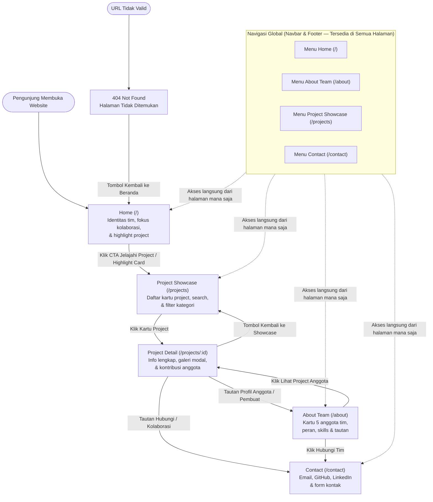

# Dokumentasi User Flow

> PIC: **Aldinda** (`W1-ALDINDA-02`)  
> Referensi: **FR-10** (Navigasi kembali dan tautan antar halaman) & Bagian 6 PRD  

Dokumen ini memetakan alur perjalanan pengguna (*user flow*) pada **Team Portfolio Website**, mencakup alur utama penjelajahan portofolio tim serta jalur navigasi global melalui Navbar dan Footer.

---

## 1. Diagram Alur Pengguna (Mermaid)

---

## 2. Alur Interaksi Detail per Halaman

### A. Alur Utama (`Home -> Project Showcase -> Project Detail -> Lanjutan`)
1. **Home (`/`)**:
   - Pengunjung melihat ringkasan identitas tim, nilai/fokus tim, serta daftar *highlight project* yang diambil dari API.
   - Pengunjung dapat menekan tombol ajakan (*CTA*) menuju **Project Showcase (`/projects`)** atau langsung memilih salah satu kartu project unggulan menuju **Project Detail (`/projects/:id`)**.
2. **Project Showcase (`/projects`)**:
   - Menampilkan grid seluruh project anggota tim.
   - Pengunjung dapat mengetik kata kunci di **SearchBar**, memilih **CategoryFilter**, atau menekan **Reset** (jika tidak ada hasil cocok, tampil *empty state*).
   - Mengklik salah satu `ProjectCard` membawa pengunjung ke **Project Detail (`/projects/:id`)**.
3. **Project Detail (`/projects/:id`)**:
   - Menampilkan latar belakang, tujuan, fitur, teknologi, kontribusi anggota, tautan repository/demo, serta galeri screenshot (klik gambar untuk membuka modal preview; tutup dengan tombol close, klik overlay, atau tombol `Esc`).
   - Dari halaman ini tersedia 3 jalur lanjutan utama:
     - **Kembali ke Project Showcase (`/projects`)** (query pencarian & filter kategori sebelumnya tetap dipertahankan).
     - **Ke Profil Anggota (`/about`)** untuk melihat biodata lengkap pembuat project.
     - **Ke Halaman Contact (`/contact`)** untuk mengirim pesan atau kolaborasi.

### B. Jalur Navigasi Global (`NavBar` & `FooterBar`)
- **NavBar** tampil konsisten di bagian atas seluruh halaman (menu desktop dan hamburger menu di mobile) dengan penanda halaman aktif (*active state*), sehingga pengguna dapat berpindah langsung ke:
  - `Home` (`/`)
  - `About Team` (`/about`)
  - `Project Showcase` (`/projects`)
  - `Contact` (`/contact`)
- **FooterBar** tampil di bagian bawah seluruh halaman dan menyediakan tautan navigasi cepat serta informasi kontak tim.

### C. Alur Halaman Pendukung & Penanganan State
- **About Team (`/about`)**: Menampilkan 5 kartu anggota (`ProfileCard`) dari API. Setiap kartu memuat avatar, nama, peran, skema, skills, tautan GitHub/LinkedIn, dan tombol menuju project anggota terkait (`/projects/:id`).
- **Contact (`/contact`)**: Menampilkan tautan kontak langsung (email, GitHub, LinkedIn) dan formulir pesan dengan validasi inline (nama wajib, email valid, pesan minimal 10 karakter) serta umpan balik sukses/error saat pengiriman.
- **State Data (`loading` / `error` / `empty`)**: Setiap halaman yang mengambil data dari API (`Home`, `About Team`, `Project Showcase`, `Project Detail`) menampilkan indikator `loading`, pesan error dengan tombol **Coba Lagi**, atau pesan `empty` jika data tidak ditemukan.
- **Route 404 (`/:pathMatch(.*)*`)**: Jika URL tidak dikenali, pengguna diarahkan ke halaman `NotFoundView` dengan tombol kembali ke Home.
